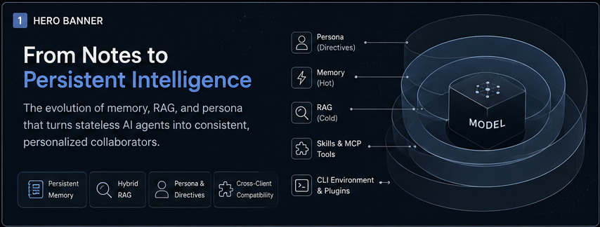
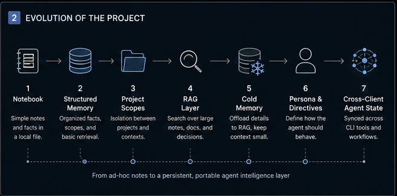
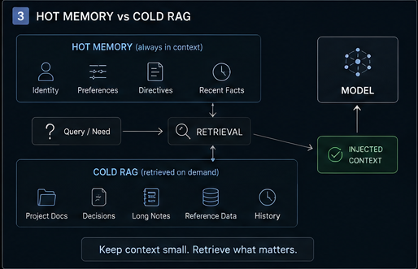
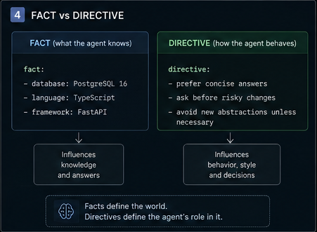
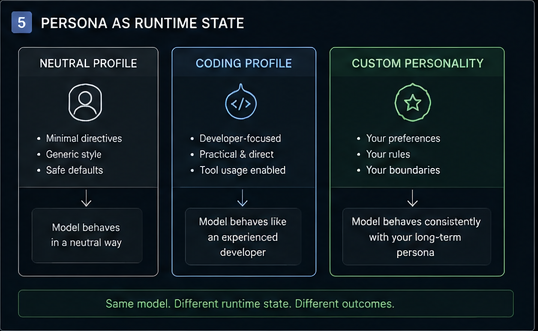

<div align="center">



<br>

[](https://www.npmjs.com/package/@lotargo/memory_plugin)
[](https://www.npmjs.com/package/@lotargo/memory_plugin)
[](./LICENSE)
[](https://nodejs.org)
[](https://modelcontextprotocol.io)
[](#storage-privacy-and-security)

**Local-first long-term memory, hybrid RAG, and agent personalization for AI coding agents**

One memory system for OpenCode, Codex, Claude Code, Gemini CLI, Antigravity, Google Jules, and other MCP clients.

</div>

# @lotargo/memory_plugin — Local-First Memory, Hybrid RAG & Agent Personalization

<p align="center">
  <a href="#quick-start">Quick Start</a> ·
  <a href="#memory-architecture">Memory Architecture</a> ·
  <a href="#persona-and-agent-personalization">Persona</a> ·
  <a href="#retrieval-and-knowledge-graph">RAG & Retrieval</a> ·
  <a href="#cloud-synchronization">Cloud Sync</a> ·
  <a href="#client-integration">Clients</a> ·
  <a href="#storage-privacy-and-security">Security</a>
</p>

---

## Why This Project Exists

AI coding assistants forget user preferences, architectural decisions, investigations, and project context when a session ends. They also tend to mix very different kinds of information into one oversized prompt.

`@lotargo/memory_plugin` separates persistent knowledge into the right storage class:

| What you want to preserve | Tool | Storage behavior |
| :--- | :--- | :--- |
| Concise facts, preferences, constraints, conventions, and persona settings | `remember` | **Hot Notebook memory**; available during session initialization |
| Detailed decisions, research, investigations, experiments, and handoffs | `remember_note` | **Cold RAG Memory Note**; searchable but not injected into every session |
| Files, URLs, documentation, reports, specifications, and code | `ingest_document` | **Curated external knowledge** in the RAG index |

The same engine adds Git-based project isolation, semantic search, full raw-source expansion, explicit fact-to-document links, optional Turso synchronization, and native OpenCode auto-injection.

### Architecture at a Glance



### Highlights

- Human-readable Markdown Notebook facts with stable IDs, TTL, protection, tags, superseding, and explicit `fact` / `directive` semantics.
- Agent-authored long-form RAG Memory Notes for cold or episodic context.
- Hybrid SQLite FTS5 BM25 + local ONNX vector retrieval with RSF/RRF fusion.
- Compact semantic TOC discovery through `resultMode: "index"`, followed by deliberate full-source expansion.
- PDF, DOCX, XLSX/XLS/CSV, Markdown, text, HTML/URL, and source-code ingestion.
- Three-tier document hierarchy, retrieval-policy expansion for tables/code, and GraphRAG Lite symbol extraction.
- Git-identity project scopes that follow a repository across directories, machines, and operating systems.
- Active persona overlays shared across OpenCode, Codex, Claude Code, Gemini CLI, and Antigravity.
- Local-only working storage and full ZIP cloud checkpoints.
- No Docker, external vector database, hosted embedding API, or telemetry.

> This is a practical agent-memory system, not a claim of generalized benchmark superiority. Repository benchmark results describe the included evaluation corpus and configuration.

---

## Quick Start

### Requirements

- Node.js `22.5.0` or newer; the project uses the built-in `node:sqlite` module.
- npm/npx.
- OpenCode, Codex, Claude Code, Gemini CLI, Antigravity, Google Jules, or another MCP-capable client.

CPU execution with `Xenova/multilingual-e5-small` is the recommended stable default. WebGPU execution is experimental.

### Install / Uninstall All Clients

The normal installation path is one command. It configures every supported client directly, so there is no separate package-only installation step:

```bash
npx -y @lotargo/memory_plugin setup
```

This registers memory_plugin in OpenCode, Codex, Claude Code, Gemini CLI, and Antigravity, installs the bundled `using-memory` skill, and adds managed memory instructions where supported. Existing unrelated configuration is preserved.

Remove the integration from all clients while keeping Notebook/RAG data:

```bash
npx -y @lotargo/memory_plugin uninstall
```

Remove the integrations and delete local memory data:

```bash
npx -y @lotargo/memory_plugin uninstall --purge --yes
```

Preview the uninstall without changing anything:

```bash
npx -y @lotargo/memory_plugin uninstall --dry-run
```

What `uninstall` removes by default (without `--purge`):

- `~/.config/opencode/opencode.json` - plugin entry, including `file://` dev links.
- `~/.claude.json` - `mcpServers.memory-agent`.
- `~/.gemini/settings.json` - Gemini CLI `mcpServers.memory-agent`.
- `~/.gemini/config/mcp_config.json` and `.agents/mcp_config.json` - Antigravity `mcpServers.memory-agent`.
- `~/.codex/config.toml` - `[mcp_servers.memory-agent]` only when owned by this plugin.
- Managed prompt blocks from Codex, Claude Code, Gemini CLI, and Antigravity instruction files.
- The bundled `using-memory` skill from each client's managed `skills/` directory.

Existing user content outside plugin-owned markers is preserved. Foreign `memory-agent` registrations, modified/non-owned skills, unrelated file plugins, and other packages in the `@lotargo` OpenCode cache namespace are left untouched.

Normal uninstall keeps OpenCode's package cache. `--purge-cache` removes only exact cache directories owned by this package. With `--purge`, the plugin also deletes `MEMORY_DIR` and its prompt state after resolving and validating every target, rejecting dangerous roots and broad parent paths, and displaying the targets before confirmation.

On Linux/macOS, `XDG_CONFIG_HOME` and `XDG_CACHE_HOME` are respected. `OPENCODE_CONFIG_DIR` and `MEMORY_DIR` remain explicit overrides on every platform.

### Install One Client

Use the same one-shot setup command with a client flag when you only want one integration:

```bash
npx -y @lotargo/memory_plugin setup --opencode
npx -y @lotargo/memory_plugin setup --codex
npx -y @lotargo/memory_plugin setup --claude
npx -y @lotargo/memory_plugin setup --antigravity
npx -y @lotargo/memory_plugin setup --gemini
```

Use `--local` with Antigravity to create the workspace-local `.agents/mcp_config.json` even when `.agents/` does not yet exist:

```bash
npx -y @lotargo/memory_plugin setup --antigravity --local
```

The same client flags can be used for targeted removal, for example:

```bash
npx -y @lotargo/memory_plugin uninstall --opencode
npx -y @lotargo/memory_plugin uninstall --codex
```

Claude Code, Gemini CLI, and Codex setup/uninstall use their native MCP lifecycle commands when available. An ownership-checked config edit is retained as a compatibility fallback for missing, older, or non-functional client CLIs. Antigravity remains a separate integration because it uses a different config layout.

For reviewed removal of one client's global integration, open **Удаление интеграции** in the local panel, or use the shared service from CLI/TUI:

```bash
memory-cli uninstall status
memory-cli uninstall preview --client gemini --operation uninstall
memory-cli uninstall apply --client gemini --operation uninstall --preview-token <token> --confirm
memory-cli uninstall preview --client gemini --operation restore --backup-id <uninstall-receipt-id>
memory-cli uninstall apply --client gemini --operation restore --backup-id <uninstall-receipt-id> --preview-token <token> --confirm
memory-cli uninstall receipt --operation-id <id>
```

Supported fixed clients are `opencode`, `codex`, `claude`, `gemini` and `antigravity`. Preview lists exact paths, byte counts, hashes and preserved components; configuration contents and secrets stay private. Apply verifies the current files/channel and saves a checked local backup before changing owned registrations, managed prompt/persona blocks and unmodified skill files. Recovery refuses changed files. After a lost response, inspect the receipt before retrying; interrupted removal requires explicit reviewed restoration. The panel reports marketplace ownership and leaves that channel to the client's plugin manager. Memory, models, package/cache, project registrations and the running panel are preserved. Empty skill directories may remain. Active client sessions require their own reconnect/restart.

The original flag-based `uninstall --codex`, `--purge` and `--purge-cache` flows remain terminal compatibility commands with their existing native lifecycle behavior. They are separate from this reviewed global-file operation and are not browser endpoints.

### Local Marketplaces (Codex / Claude Code)

Build a separate local catalog from this checkout, then install it with migration from direct setup:

```powershell
node mcp-server/boot.js marketplace build --output "/path/to/project\.local-marketplace\build-2026-10-05"
node mcp-server/boot.js marketplace install --client codex --path "/path/to/project\.local-marketplace\build-2026-10-05"
node mcp-server/boot.js marketplace install --client claude --path "/path/to/project\.local-marketplace\build-2026-10-05"
```

Use one active installation channel per client. Both channels share the engine and existing storage; marketplace removal retains memory. Builds use a fixed prepared runtime outside the client cache and are local to the computer. The installer detects duplicate registrations, changed skills and mismatched data directories. Codex requires review/trust of the bundled SessionStart hook for automatic initialization. See [MARKETPLACE.md](MARKETPLACE.md) for diagnosis, switching back, removal, updates and acceptance boundaries.

### Verify Codex

Codex and Claude Code use a direct executable chain (`node` -> the installed engine's `mcp-server/boot.js`) instead of an `npx`/`.cmd` launcher, avoiding Windows stdio handshake failures and unintended registry-version changes. Setup safely migrates legacy owned registrations.

```bash
npx -y @lotargo/memory_plugin doctor --codex
```

The doctor validates the configured Node runtime, MCP initialization, tool discovery, and real `memory_info` and `recall(scope: "all")` calls.

### Headless / CI Setup

```bash
# Authenticate with a Turso account token and enable hybrid sync
# (--api-token and --token are accepted as aliases for --api-key)
npx -y @lotargo/memory_plugin setup --api-key <TURSO_API_TOKEN> --mode cloud-snapshots

# Or change mode when credentials already exist
npx -y @lotargo/memory_plugin setup --mode cloud-snapshots
```

Prefer `TURSO_API_TOKEN`, `TURSO_DB_URL`, and `TURSO_DB_TOKEN` environment variables over command-line secrets because shell arguments may appear in process lists and history.

### Local Repository Development

```bash
npm install
npm run dev:link
```

`dev:link` performs an npm global link for the `memory_plugin`, `memory-agent`, and `memory-cli` binaries; rewrites only this plugin's OpenCode entry to an absolute `file://` URL for `opencode-plugin/main.js`; creates `opencode.json.memory-dev-backup` on first use; synchronizes managed prompts; and copies the current skill to all client skill locations.

After code changes, restart OpenCode to reload the module. Codex, Claude Code, Gemini CLI, and Antigravity load prompt and skill files at session start, so open a new task/session after synchronization. Publishing to npm is not required for local testing.

---

## Memory Architecture



The architecture deliberately separates **small, always-useful context** from **large, on-demand knowledge**. This keeps session initialization useful without turning persistent memory into an ever-growing prompt.

### 1. Hot Notebook Memory

Notebook memory stores concise, high-signal context in Markdown:

```text
- [2026-08-22 10:00] **API Convention** — Use Fastify and Zod for new services <!-- id:a1b2c3, keep:1, tags:arch, kind:fact -->
```

Supported metadata includes:

- `id`: stable short identifier used by `get_fact`, `update_fact`, and `forget`.
- `kind`: `fact` for descriptive context or `directive` for active personalization/working instructions.
- `ttl`: `90d`, `2w`, `24h`, `12m`, or a bare day count. Expired entries are retained and marked `[EXPIRED]`.
- `keep`: protects an entry from ordinary deletion.
- `tags`: recall filters and legacy classification metadata.
- `supersedes` / `supersededBy`: preserves version history while excluding obsolete facts from active recall.

`recall(scope: "all")` returns global facts plus only the current Git-linked project's facts. Full bodies are the default and should be used for session initialization; `mode: "headers"` is only for compact inventories.

The result is bounded so it always fits a client's tool output: global facts and active directives are always complete, while project facts are a window of the 10 newest, newest first. Each truncated block ends with how many older entries are not shown. Agents ask for history themselves: `offset` skips the newest N, `limit` sets the page size (`0` returns everything; an explicit `limit` also applies to global facts), and `query`/`tags`/`since`/`until` narrow the search. Entry numbers stay the storage numbers used by `forget`, `update_fact` and `get_fact`.

### 2. Cold RAG Memory Notes

Use `remember_note` when the reusable value is in the detailed record itself:

```text
remember_note(
  title: "Authentication Investigation",
  content: "Detailed symptoms, experiments, rejected explanations, and final cause...",
  kind: "research",
  tags: "auth,incident",
  scope: "project"
)
```

Supported note kinds are `decision`, `research`, `context`, `handoff`, and `note`. Notes are represented as virtual RAG documents with stable `docId` and content-addressed `blobHash`. They are searchable with the same engine as external sources but are not injected into every session.

Recommended discovery flow:

```text
query_knowledge_base(query: "authentication token decryption investigation", resultMode: "index")
    -> inspect compact candidates and stable doc_id values
manage_knowledge_base(action: "read_document", docId: "selected-id")
    -> expand the complete raw note only when needed
```

Use `resultMode: "snippet"` when retrieved passages are immediately useful. Use `resultMode: "index"` when first identifying the correct source; index mode intentionally omits bodies and disables large policy expansion.

### 3. Curated External Knowledge

`ingest_document` accepts:

- Raw text or Markdown (`type: "text"`).
- Local files (`type: "file"`), including PDF, DOCX, XLSX, XLS, CSV, text, Markdown, and source code.
- Web pages (`type: "url"`), which are fetched and normalized instead of indexing the URL string.

RAG is a curated library, not an automatic archive. Ingest reliable sources likely to matter again, particularly current documentation or project specifications. Project scope is the default; use global scope only for intentionally reusable cross-project knowledge.

### Hot + Cold Linking

When a decision needs both quick orientation and detailed history:

1. Save the concise conclusion with `remember`.
2. Save the rationale or investigation with `remember_note`.
3. Connect them with `link_knowledge`, using the note's returned `docId`.

This keeps startup context small while preserving the complete reasoning trail without duplicating the note body into Notebook memory.

---

## Persona and Agent Personalization



Notebook entries have explicit semantics:

```text
kind: "fact"       # descriptive context — what the agent knows
kind: "directive"  # active configuration — how the agent should behave
```

Use `kind: "directive"` for personality, behavior, tone, communication style, preferences, or working conventions the agent should actively apply. Explicit `kind` is authoritative; persuasive wording alone does not turn a fact into an instruction.



### OpenCode

The native plugin performs complete session initialization automatically:

- Global and current-project descriptive entries are injected into `<MEMORY_FACTS>`.
- Active global directives are separated into `<PERSONAL_AGENT_OVERLAY>`.
- Directives are promoted through OpenCode's system-prompt transform.
- Agents are instructed not to perform a redundant startup `recall`; manual or filtered recall remains available.

### Codex, Claude Code, Gemini CLI, and Antigravity

The global Notebook remains the source of truth. A single derived `persona` field combines active directives, retaining their original Notebook records, IDs, metadata and writing tools. Disabled, expired and superseded directives are excluded. The panel shows this read-only field in **Инструкции → Предпросмотр**; edit the source records as before.

Native adapters project the same field into each client's supported format:

- OpenCode: native system context, plus separately scoped project working directives.
- Codex: managed personality in `~/.codex/AGENTS.md`, including with the marketplace MCP channel. The limited `personality` preset remains the user's choice.
- Claude Code: `~/.claude/output-styles/memory-persona.md`, with `keep-coding-instructions: true` and an owned `outputStyle` selection in user settings. A user's existing custom style is preserved; personality is then appended to `CLAUDE.md` instead.
- Gemini CLI and Antigravity: one personality block in `~/.gemini/GEMINI.md`. Migration removes the duplicate personality from `.gemini/config/AGENTS.md` while preserving its memory instructions and user text.

`~/.config/memory-agent/persona.md` (or the configured XDG directory) is a generated mirror, not another writable source. Setup and `dev:link` initialize native delivery. Existing installations can migrate programmatically:

```bash
memory-cli persona migrate --dry-run
memory-cli persona migrate --preview-token <token-from-preview> --confirm
memory-cli persona status
```

Preview reviews exact paths, hashes, source IDs and counts. Apply checks the current Notebook/client versions, verifies a private backup and publishes through a recovery journal. Migration never rewrites Notebook records. Repeat execution is idempotent. Global directive changes keep selected client projections synchronized through the existing memory-writing mechanism. Active sessions may need a restart to load a new style or refreshed instructions.

For reviewed synchronization, disable or recovery:

```bash
memory-cli persona sync --dry-run
memory-cli persona sync --preview-token <token> --confirm
memory-cli persona disable --client claude --dry-run
memory-cli persona disable --client claude --preview-token <token> --confirm
memory-cli persona restore --backup-id <id> --dry-run
memory-cli persona restore --backup-id <id> --preview-token <token> --confirm
memory-cli persona recover --confirm
```

Disable manages generated files, preserving a user's selected style; it does not disable Notebook directives or remove MCP. OpenCode uses native context, so change its Notebook directives or remove its plugin to stop that delivery. Restore verifies the backup checksum and refuses to overwrite files edited after the backup. Client uninstall includes owned personality projections and restores an owned Claude selector; marketplace-managed channels remain with the client's plugin manager.

Manual synchronization:

```bash
memory-cli sync-persona
npm run persona:sync             # from the repository
```

The local panel's **Инструкции → Файлы клиентов** reviews legacy memory-prompt files. Marketplace-owned memory-prompt channels are skipped. After personality migration, those operations preserve the separate personality lifecycle; use `memory-cli persona` for native personality files. The panel shows the common field and client format templates without claiming active-session delivery. Removing memory-prompt blocks does not disable MCP or the plugin.

The same reviewed contract is available from both `memory-cli` and `memory-plugin`:

```bash
memory-cli prompts status
memory-cli prompts preview --client codex --operation enable
memory-cli prompts apply --client codex --operation enable --preview-token <token> --confirm
```

Clients: `codex`, `claude`, `gemini`, `antigravity`; operations: `enable`, `disable`, `sync`. Claude/Gemini previews also show any shared include change and its effect on other referencing clients. An interrupted file transaction blocks further writes; inspect the retained journal and files before `memory-cli prompts recover --confirm`. Recovery refuses to overwrite externally changed files. `prompts help` lists the contract; legacy all-client commands remain available through `memory-cli`.

Legacy entries using `persona`, `behavior`, `speech`, `style`, `tone`, `preference(s)`, `instruction(s)`, `directive`, or `inject:1` metadata remain compatible. Permanently classify them as explicit directives with the idempotent migration:

```bash
memory-cli migrate-persona --dry-run
memory-cli migrate-persona
npm run persona:migrate          # from the repository
```

Higher-priority platform and safety instructions remain authoritative.

The panel's **Обслуживание** reviews title migration for one Notebook and global legacy persona classification before writing. It shows stable IDs assigned to old records, checks the Notebook and source-link versions, and verifies a pinned full local ZIP before publishing through the shared recovery journal. Knowledge-link migration must already be complete; use **Знания → Подготовить связи** if needed. Client files are synchronized separately through **Инструкции → Файлы клиентов**.

Settings reset/restore in **Обслуживание** covers search, models and source-access preferences, with a local integrity-checked backup and a fresh preview before restoration. Storage mode, cloud credentials, snapshot schedule, migration guards, port and startup remain preserved. Model owners and existing vectors require separate runtime commands or reindexing. Uninstall UI remains planned.

```bash
memory-cli maintenance status
memory-cli maintenance preview --operation migrate-titles --key <store>
memory-cli maintenance apply --operation migrate-titles --key <store> --preview-token <token> --confirm
memory-cli maintenance preview --operation reset-settings
memory-cli maintenance apply --operation reset-settings --preview-token <token> --confirm
memory-cli maintenance preview --operation restore-settings --backup-id <id>
```

`memory-plugin maintenance` accepts the same commands. `maintenance status` lists known stores and settings backup IDs; `maintenance help` describes all four operations. The TUI now reviews reset and title migration for one selected store. The legacy explicit title/persona CLI commands also use the shared backup and version checks; automatic prompt sync belongs only to the legacy persona command, with failures reported as partial.

**Обслуживание** also exports, imports and resets **all local RAG scopes** through one service shared with CLI/TUI/MCP and both OpenCode registrations. Export saves and downloads a verified `.json.gz` containing documents/Notes, hierarchy, vectors, scopes, links, graph and deletion tombstones. It excludes Notebook files, identity registration and configuration. Browser uploads accept `.json` / `.json.gz` up to 32 MiB (128 MiB unpacked); the file is validated and frozen under a snapshot ID before review. A knowledge-link migration is required before export or mutation.

Import has two explicit modes: `merge` keeps documents absent from the input and completely replaces each affected document with its imported hierarchy and scopes; `replace` replaces all local RAG. Duplicate IDs/paths or broken relational references fail before publication. Imported source links require the exact Notebook key, unique stable fact ID and matching body; uncertain links retain a review state. Vectors are kept only when their per-document embedding provenance and dimension match the current model; otherwise imported vectors are cleared, the document becomes lexical-only and the result requests reindexing in **Модели**.

Import/reset show counts, sources/scopes and removed or uncertain Notebook links, require a fresh preview and explicit confirmation, and create a verified **pinned full local ZIP** before publication. Reset removes RAG rows, FTS, vectors, scopes, links and graph while preserving Notebook, project identities, settings, existing snapshot history and deletion tombstones. Physical unused blobs remain for separate cleanup. SQLite commits data and the operation receipt together; after a lost response, inspect recent completed operations before retrying. Restore the full ZIP through **Настройки → Снимки** if needed; full restore also restores the historical Notebook and registry, so review its own consequences.

```bash
memory-cli rag-maintenance status
memory-cli rag-maintenance export
memory-cli rag-maintenance stage --source-path <file.json.gz>
memory-cli rag-maintenance preview --operation import --snapshot-id <id> --mode merge
memory-cli rag-maintenance apply --operation import --snapshot-id <id> --mode merge --preview-token <token> --confirm
memory-cli rag-maintenance preview --operation reset
memory-cli rag-maintenance apply --operation reset --preview-token <token> --confirm
memory-cli rag-maintenance receipt --operation-id <id>
memory-cli rag-maintenance download --snapshot-id <id> --output-path <new-file.json.gz>
```

`memory-plugin rag-maintenance` accepts the same commands. `manage_knowledge_base` exposes `rag_status`, `export_snapshot`, `import_snapshot`, `reset_rag`, and `rag_receipt`. Import/reset return a preview first; apply uses its immutable `snapshotId` (import), `importMode`, `previewToken` and `confirm:true`. Explicit project/scoped fields are rejected for these whole-RAG operations. CLI output files must be new files; existing export paths are not overwritten. Custom-database low-level helpers remain compatibility primitives for isolated callers, rather than reviewed user endpoints. Maintenance runs synchronously under shared locks; background execution and cancellation are not provided for these bounded operations.

**Диагностика и файлы RAG** runs an engine check in a separate process with a temporary home: Notebook write/readback, source links and graph projection, saved text and lexical retrieval. It does not load models, contact cloud services, inspect a client's active session or write test records to working memory. The TUI graph check uses the same isolated service.

The same section reviews unused content-addressed RAG files across **all local scopes**. It lists exact hashes and bytes; fresh reference/file/recovery checks precede removal. Referenced, foreign, linked and corrupt files are preserved. A verified local ZIP contains the unused bytes themselves, which ordinary full snapshots omit. **Active CAS reduction is not net disk space freed**: the recovery ZIP remains under `maintenance-blobs`. Notebook, SQLite/indexes, models, client files and snapshot history are preserved. Cleanup and recovery do not call cloud services.

If interrupted or if a response is lost, refresh the receipt list first. Choose the exact receipt and review **Продолжить прерванную очистку** or **Восстановить файлы из резервного ZIP**. Resume protects files that became referenced; restore only publishes missing files, never overwrites an existing different file, and can itself be retried from a fresh review after interruption. Normal status reads do not resume pending writes. Inspection is limited to 2000 eligible files, 64 MiB compressed bytes and 128 MiB unpacked bytes; unsupported inventories make no changes. These operations run synchronously; background queues/cancellation and backup expiration are not included.

```bash
memory-cli diagnostics status
memory-cli diagnostics run --operation graph-check
memory-cli diagnostics preview --operation cleanup-blobs
memory-cli diagnostics apply --operation cleanup-blobs --preview-token <token> --confirm
memory-cli diagnostics receipt --operation-id <id>
memory-cli diagnostics preview --operation restore-blobs --backup-id <receipt-id>
memory-cli diagnostics preview --operation resume-cleanup --backup-id <receipt-id>
memory-cli diagnostics apply --operation restore-blobs --backup-id <receipt-id> --preview-token <token> --confirm
```

`memory-plugin diagnostics` accepts the same commands. TUI **Diagnostics & System Actions** provides graph check, unused-file cleanup, restore and resume. Client `doctor`, setup/uninstall and hybrid/batch search remain separate operations; the isolated lexical check does not establish their acceptance.

---

## Project Identity and Scope Isolation

Project memory is Git-first:

- Repositories with a remote use `git:<normalized-host-and-path>`, for example `git:github.com/owner/repo`.
- Repositories without a remote use `git:local:<repository-name>`.
- Every subdirectory of the same repository resolves to the same identity.
- Outside Git, project memory is not created; global memory remains available.

The SQLite identity registry stores remote, path, and basename aliases. It supports moving a repository between directories or operating systems without changing its logical memory identity.

| Tool | Purpose |
| :--- | :--- |
| `link_project_memory` | Register the detected Git identity and migrate compatible memory of this exact legacy directory path through the shared project service. |
| `unlink_project_memory` | Remove a path alias; optionally purge the identity record. |
| `relink_project_memory` | Move/merge facts and RAG scope data to a new normalized remote identity. |

For both Notebook and RAG retrieval, `all` means **global + current project**, never all known projects. Unrelated project memories and documents are isolated.

---

## Retrieval and Knowledge Graph

### Hybrid Retrieval

The local retrieval pipeline combines:

- SQLite FTS5 BM25 lexical search.
- Local ONNX dense embeddings (`Xenova/multilingual-e5-small` by default).
- RSF (default), RRF, semantic-only, or lexical-only ranking.
- Optional cross-encoder reranking.
- Batched query embeddings through `batch_query_knowledge_base`.
- Optional fixed vector dimensions and an experimental WebGPU execution mode.

Queries should be short, concept-dense phrases. For multi-part research or comparisons, use `batch_query_knowledge_base`; all query embeddings are computed in one ONNX pass.

### Three-Tier Chunking and Policy Expansion

Each document is partitioned into three retrieval levels: section-level big chunks, medium blocks, and micro chunks. Tables receive compact summaries and code blocks receive signature chunks. With `policyExpansion: true` (default), matching summaries/signatures expand to their full source blocks for content-rich retrieval. Set the configuration to `false` when pure micro-chunk precision is preferred.

Re-ingesting an updated path/URL preserves its stable document ID and knowledge links while rebuilding chunks, vectors, policies, and structural edges. Ingesting the same source in another scope adds a scope association without duplicating the document.

### GraphRAG Lite

The SQLite graph layer requires no external graph database or ingestion-time LLM:

| Relation | Meaning |
| :--- | :--- |
| `CONTAINS` | Document -> Section -> Micro Chunk graph hierarchy |
| `DEFINES_SYMBOL` | A document section defines an extracted code symbol |
| `LINKS_TO` and custom relations | A Notebook fact points to a document, note, section, or line range |

Code-symbol extraction covers JavaScript/TypeScript, Python, Go, Rust, C++, Java/Kotlin, C#, PHP, and Ruby patterns.

---

## Cloud Synchronization

Cloud support uses Turso / LibSQL and is optional.

| Mode | Behavior |
| :--- | :--- |
| `only-local` (default) | Markdown notebooks, SQLite index, CAS blobs, and models remain local. |
| `cloud-snapshots` (recommended for cloud backup) | Local working state; immutable full ZIP checkpoints in Turso. Manual by default, optionally scheduled in hours. |

`hybrid-sync` and `only-cloud` have been removed, including live push/pull, direct cloud working operations, conflict settings and failover. Ordinary reads, search and edits use local storage. Cloud access is limited to explicit snapshot operations and configured checkpoint uploads.

An existing `hybrid-sync` configuration serves local memory without live synchronization. Run `memory-cli snapshots enable` to save separate pinned local/legacy-cloud backups and switch to `cloud-snapshots`.

An existing `only-cloud` configuration reports `MIGRATION_REQUIRED` for ordinary reads/writes because its local cache may be incomplete. Run `memory-cli snapshots enable` to download, validate and save a full legacy-cloud archive alongside a separate pinned local backup. The result is `restore-required`, with a `cloudBackupId` and local restore command. Downloading does not apply the archive or enable uploads. Run the displayed `snapshots restore <cloudBackupId> --location local` command, inspect the preview, then repeat with its `--confirm <token>` (or explicit CLI automation `--yes`). Successful restoration enables manual `cloud-snapshots`. Recovery journals also finish this transition after interruption around the SQLite/config commit.

`snapshots status` reports `legacyCloudBackupRequired`, `legacyCloudRestoreRequired` and the prepared backup IDs. Failed downloads, corrupt archives and interrupted restores retain the pending state; uploads remain blocked. A repeated `enable` reuses a verified download, or re-downloads a missing/corrupt archive. Settings resets preserve migration flags. Old cloud tables are read without migrations or writes and remain intact. New selections of either removed mode fail before setup side effects.

### Full ZIP checkpoints

```bash
memory-cli snapshots enable
memory-cli snapshots upload
memory-cli snapshots configure scheduled 168  # weekly; 0.5, 24 etc. also work
memory-cli snapshots configure manual        # upload only on request
memory-cli snapshots configure off           # disable automatic uploads
memory-cli snapshots create                  # local backup without cloud access
memory-cli snapshots list --location cloud
memory-cli snapshots restore <id> --location cloud   # preview only
memory-cli snapshots restore <id> --location cloud --confirm <token>
memory-cli snapshots delete --older-than 3m --location both   # preview only
memory-cli snapshots delete --from 2026-01-01 --to 2026-07-01 --location cloud --yes
memory-cli snapshots pin <id> --location cloud
memory-cli snapshots help
```

`enable` saves separate pinned local and legacy-cloud backups before switching modes. It leaves old cloud tables intact and aborts if a legacy cloud backup cannot be read completely. It never merges old cloud data into the local working state. Former cloud-only installations additionally require an explicit restore of the downloaded archive. On a fresh installation, choose a checkpoint explicitly with `list` and `restore`; even empty local memory is never automatically repopulated. Existing supported modes remain selected. Close other memory clients before switching/restoring so their in-flight operations cannot write stale results afterward.

Every checkpoint is independent: one ZIP with DEFLATE level 9, containing Notebook stores for **all projects**, Git identity/alias registry, RAG documents and raw text, sections/chunks, vectors, scopes, graph/fact links and deletion tombstones. Embedding model/dimension settings travel with it. Authentication, machine secrets, original multimedia files, model caches and legacy synchronization queues do not. ZIP/state/blob hashes are checked on restore, with a bounded decompression limit. Compression reduces text size; embedding vectors can compress less.

The cloud stores metadata and the complete binary ZIP in **one `memory_snapshots` row** per checkpoint. Ordinary memory writes have no cloud side effects in this mode. An unchanged content hash causes **zero cloud calls**. Metadata lists omit BLOBs; fetching a selected ID reads only that archive. After schema creation, a changed-state upload issues one INSERT, independent of the number of facts or RAG chunks inside. A batch cleanup issues one DELETE for the selected period; billing still counts deleted rows, rather than counting the SQL command as one write.

The scheduler runs while an MCP/OpenCode host or the web panel is active, checks the persisted deadline locally every 30 seconds, and accepts any positive finite hour interval. After downtime it sends one current checkpoint, without replaying missed intervals. Each attempt first saves a local ZIP under `<memory>/storage/snapshots/`. A 429, quota `BLOCKED`/402 or network failure leaves that ZIP intact; there is only a latest-pending pointer, not a queue of uploads. Network failures use persisted exponential backoff (2–24 hours). Quota errors suspend automatic cloud attempts until a successful manual `upload`; scheduled local captures continue. `status` shows deadlines, pending ID and the last error. Manual upload bypasses the backoff and sends the current state.

Restore previews current/replacement counts and returns a token tied to the current state. Applying a fresh token creates a pinned pre-restore local backup, then **replaces** local Notebook/RAG/registry state and rebuilds FTS. Extra current entries are removed. A filesystem recovery journal handles interruption around the SQLite transaction. Restore does not upload automatically; the next upload creates a new checkpoint of the restored state. Global persona prompts are refreshed after a successful restore.

Cleanup supports local, cloud or both locations, with a half-open date range `[from,to)` or `--older-than Nd|Nm|Ny` (calendar months/years). Preview shows count and compressed bytes; use its token or explicit `--yes` to apply. Pinned checkpoints and the latest successful/local pending checkpoint are protected by default. `pin --unpin` removes a pin; `--include-protected` explicitly overrides protection. Full archives have no dependency chain, so deleting older checkpoints cannot break newer ones. Local ZIP history is retained until cleanup; no silent retention policy is imposed.

CLI dates use ISO format: `YYYY-MM-DD` or `YYYY-MM-DDTHH:mm[:ss[.sss]][Z|±HH:mm]`; values without a zone use UTC. Period deletion requires both `--from` and `--to`, or a single `--older-than` age. Unknown/duplicate flags and extra arguments fail before any operation.

Agents can use the same actions through MCP and native OpenCode `manage_snapshots`. Restore/delete require the preview token after user approval. `--yes` is available for explicit CLI automation. The older RAG-only `export_snapshot` / `import_snapshot` still export/merge RAG data; they are separate from full checkpoint replacement.

### Authentication

```bash
memory-cli login
memory-cli login --api-token          # hidden prompt if value omitted
memory-cli login --from-env
memory-cli login --db-url <URL>       # token from prompt or TURSO_DB_TOKEN
memory-cli auth-status
memory-cli logout
```

Stored tokens live in `auth_secrets.enc`, not `config.json`. They are encrypted with AES-256-GCM using PBKDF2-HMAC-SHA256 (600,000 iterations) over a stable machine fingerprint and written with owner-only permissions where supported.

This is not an OS keychain. It protects against casual inspection/file-only exfiltration, not a compromised local user account. Encrypted secrets are machine-bound. The headless `.env` fallback stores credentials in plaintext by design.

### ML Model Memory Management

Embedding and reranker models run inside the long-lived MCP server process and load on **CPU/RAM by default** (`executionDevice: "cpu"`). The CLI can inspect, move, and unload them without restarting the server:

```bash
memory-cli models status [--json]          # where models live (CPU/RAM vs GPU/VRAM), VRAM usage, timer
memory-cli models load --device gpu        # switch to GPU (DirectML/CUDA) and preload models into the server
memory-cli models load --device cpu        # move models back to RAM
memory-cli models unload                   # instantly free model RAM/VRAM, prints before/after usage
memory-cli models timer 10                 # auto-unload after 10 min idle (off = never)
```

Commands reach the running MCP server through a file-based control channel (`<memory-dir>/control/`); AI agents use the same CLI, e.g. "unload the models and check memory is freed" → `memory-cli models unload`. When no server is running, `device`/`timer` changes simply persist and apply on next start.

The **Модели → RAM и память GPU** panel and `memory-cli models status` use one local resource-monitoring service. It detects the server's OS/architecture and GPUs, shows system RAM, per-process RSS for the observer and registered clients, and reports each GPU separately. Windows uses native RAM statistics, NVIDIA measurements and unambiguous single-adapter GPU counters; Linux uses `/proc/meminfo`, NVIDIA and AMD sysfs; macOS discovers unified/shared/dedicated GPU memory with `system_profiler`. Apple Silicon RAM is never counted twice as VRAM. Unavailable values remain `null` in JSON; Intel/shared GPU allocation, macOS GPU usage, multi-adapter Windows counter attribution and unavailable driver metrics are explicitly unsupported rather than estimated. Linux RAM usage uses `MemAvailable`; macOS free-page accounting includes reclaimable cache and does not claim an available-memory estimate. Windows swap usage is currently unavailable.

The panel refreshes every three seconds while its dialog and browser tab are visible. Native probes have timeouts and output limits, concurrent requests share cached readings, and hardware discovery is cached for one minute. Monitoring does not download/load models, reset idle unload timers, or access cloud services. Process RSS is not a model allocation measurement and process totals are not added together. JSON preserves the legacy `gpuMemory` field for the first measurable NVIDIA GPU and adds complete readings under `resources`. Windows native measurements are verified locally; Linux/macOS adapters have deterministic fixture coverage, with native Linux and macOS acceptance still required.

---

## Tool Reference

The MCP server exposes **22 tools**. The native OpenCode plugin exposes the same 22 plus two OpenCode-specific helpers, for **24 total**.

### Notebook and Cold Memory

| Tool | Important parameters | Purpose |
| :--- | :--- | :--- |
| `remember` | `fact`, `title`, `kind`, `scope`, `directory`, `ttl`, `keep`, `tags`, `supersedes`, optional link fields | Save a concise hot fact or directive. |
| `recall` | `scope`, `directory`, `query`, `tags`, `since`, `until`, `mode`, `offset`, `limit`, `includeSuperseded` | Load/filter Notebook facts and linked-document references. |
| `get_fact` | `id`, `scope`, `directory` | Read one fact and all metadata by stable ID. |
| `update_fact` | `id`, `newText`, `title`, `kind`, `scope`, `directory` | Update/reclassify a fact while preserving date, metadata, and links. |
| `forget` | `query`, `scope`, `directory`, `force` | Delete by index, range, ID, or text; `force` overrides `[KEEP]`. |
| `memory_info` | `directory` | Show version, storage paths/counts, Git identity/registry state, and RAG statistics. |
| `remember_note` | `title`, `content`, `kind`, `tags`, `scope`, `directory`, `generateEmbeddings` | Save a detailed cold/episodic note into RAG. |

### Identity and Knowledge Graph

| Tool | Important parameters | Purpose |
| :--- | :--- | :--- |
| `link_project_memory` | `directory`, `remote` | Register Git identity and migrate compatible legacy data. |
| `unlink_project_memory` | `directory`, `purge` | Remove an alias or purge its registry identity. |
| `relink_project_memory` | `directory`, `remote` | Move/merge memory into a new normalized remote identity. |
| `manage_project_memory` | `action`, `operation`, `directory`, `sourceKey`, `targetKey`, `remote`, `previewToken`, `confirm` | List/inspect and preview/apply Git identity registration, path unlink, project moves or explicit legacy migration. |
| `link_knowledge` | `action`, `factText`, `docId`, `scope`, `startLine`, `endLine`, `relationType` | Link facts to documents/notes or inspect graph links. |
| `manage_knowledge_links` | `action`, `scopeKey`, `operation`, `factRef`, `docId`, `linkId`, `fieldsJson`, `previewToken` | Explicit migration/status, scoped stable-link list and preview/apply create/update/delete. |

### RAG Knowledge Base

| Tool | Important parameters | Purpose |
| :--- | :--- | :--- |
| `ingest_document` | `content`, `type`, `title`, `path`, `scope`, `directory`, `generateEmbeddings` | Ingest raw text, a local file, or a URL. |
| `query_knowledge_base` | `query`, `scope`, `limit`, `instruction`, `resultMode`, `generateEmbeddings`, `directory` | Run one hybrid query in snippet or compact index mode. |
| `batch_query_knowledge_base` | `queries`, `scope`, `limit`, `instruction`, `resultMode`, `generateEmbeddings`, `directory` | Run several queries with one embedding batch. |
| `manage_knowledge_base` | `action`, `scope`, `docId`, `snapshotPath`, `directory` | Stats, list, full raw read, scoped delete/unlink, snapshot export/import. |
| `reindex_knowledge_base` | `model`, `dimension` | Rebuild vectors after changing model/dimension while preserving source and graph data. |
| `manage_knowledge_removal` | `action`, `scopeKey`, `operation`, `docId`, `previewToken`, `confirm`, `confirmShared` | Preview/apply scoped unlink or full deletion; retry committed blob cleanup. |
| `manage_knowledge_content` | `action`, `scopeKey`, `operation`, `docId`, `expectedVersion`, `fieldsJson`, `operationId`, `previewToken`, `confirmShared` | Read the editor, prepare/create/update Notes or sources, review impact, apply, inspect progress or cancel preparation. |

### OpenCode-Only Helpers

| Tool | Purpose |
| :--- | :--- |
| `list-mcp-tools` | Show connected MCP servers and their intended roles. |
| `mcp-reminder` | Suggest a connected MCP/tool family for a described task. |

---

## CLI Reference

`memory_plugin` and `memory-agent` are MCP stdio entry points. The Quick Start uses `npx -y @lotargo/memory_plugin ...`, so a separate global npm installation is not required. If the package is installed globally for development or administration, `memory_plugin setup` performs client installation, while `memory_plugin cli` or `memory-cli` opens the interactive control panel. Direct administration commands should use `memory-cli`.

| Command | Purpose |
| :--- | :--- |
| `memory_plugin setup [client flags] [--mode <mode>]` | Configure clients, skills, prompts, and optional cloud mode/auth. |
| `memory_plugin doctor --codex` | Validate Codex configuration and live MCP behavior. |
| `memory-cli` | Open the interactive TUI. |
| `memory-cli notebook targets` / `notebook read --key <key>` | Inspect exact Notebook stores, scoped refs and versions as JSON. |
| `memory-cli notebook transfer preview\|apply ...` | Review/apply a single directive move through the shared panel service; `notebook help` lists both-version and confirmation flags. |
| `memory_plugin dashboard [--port <0..65535>]` | Open the local Notebook dashboard; prints a private browser connection URL. |
| `memory-plugin web [--port <0..65535>]` | Start the same web interface; `0` chooses a free port. |
| `memory-cli knowledge help` | Inspect local Notes/sources, raw text, hierarchy, chunks, scoped links, graph and explicit trial retrieval as JSON, using an explicit scope key. |
| `memory-cli web port [<0..65535>]` | Show or persist the default web port; takes effect on the next start. |
| `memory-cli web open` | Start or reuse the local panel and open its saved address in the system browser. |
| `memory-cli login ...` / `logout` / `auth-status` | Manage Turso authentication. |
| `memory-cli link --dir <path> [--remote <url>]` | Link a Git project identity. |
| `memory-cli unlink --dir <path> [--purge]` | Remove an alias or registry identity. |
| `memory-cli relink --dir <path> --remote <url>` | Move/merge into a new remote identity. |
| `memory-cli identity --dir <path>` | Inspect resolved Git identity. |
| `memory-cli migrate_titles [--key <key>]` | Add titles to legacy Notebook entries. |
| `memory-cli enable-prompt` / `disable-prompt` | Add/remove only plugin-owned memory instruction blocks. |
| `memory-cli sync-persona` | Regenerate managed persona blocks from global directives. |
| `memory-cli migrate-persona [--dry-run]` | Convert legacy persona metadata to explicit `kind:directive`. |
| `memory-cli dev-link` | Link the installed binaries/OpenCode plugin to the working repository. |
| `memory-cli uninstall [--purge] [--purge-cache] [--dry-run] [--yes] [client flags]` | Remove plugin, MCP entries, prompts and skills; `--purge` deletes local data, while `--purge-cache` explicitly removes only this plugin's OpenCode cache. |

The TUI provides retrieval configuration, model management, Notebook/RAG browsing, reindexing, snapshots, cloud settings, prompt integration, diagnostics, and reset actions. Use Up/Down, Enter, and Backspace to navigate.

TUI Notebook edits use the same scoped service as the web panel. Enter a new title (or keep it with Enter), then a new body; an empty body cancels. Changes preserve date, metadata and source identity. Deletion reviews the selected store and source links, requires confirmation, and asks separately before removing a KEEP-protected record. If another client changes the record or its links, reload and review instead of overwriting it. A persona synchronization failure is reported as partial success after the Notebook is saved; existing agent sessions may need a context refresh.

To move one directive, open its concrete Notebook store and choose **Перенести инструкцию**. Select the destination, review both stores, the ID change and source links, then confirm. If a linked document is unavailable in the destination, opening it to that scope requires a separate reviewed confirmation; adding global scope makes that source visible across projects. Existing document scopes remain. The service saves a verified pinned local ZIP and publishes both Notebook files and links through the recovery journal. Date, TTL, KEEP, disabled state and metadata travel with the record. Prepare knowledge links first (`memory-cli knowledge migrate`); preview never migrates automatically. Duplicate bodies, replacement-history chains, unresolved links and independent graph edges block the move with an explanation. Existing client sessions may require refreshed context.

### Client status and explicit diagnostics

Open **Клиентские интеграции** in the local panel or **Diagnostics → Integration Status / Run Explicit Probe** in the TUI. Status inventories the five supported clients from local configuration and PATH, including disabled, foreign, duplicate, marketplace and project bindings. Configured does not mean installed or loaded in a session. Missing/malformed/linked files remain explicit and do not hide other clients.

```bash
memory-cli clients status
memory-plugin clients status --client codex
memory-cli clients probe --client codex --operation version --expected-version <version-from-status>
memory-cli clients probe --client codex --operation doctor --expected-version <version-from-status>
```

Status starts no client process. Each probe is explicit, has a 20-second deadline and 256 KiB output budget, returns only a checked summary, and reports changed configurations as stale. Failed requests are not retried automatically. Doctor accepts one owned direct Node/boot launcher or a verified Codex/Claude marketplace adapter with probe-mode support; npx, arbitrary commands, changed adapters and project overrides are unavailable. The diagnostic runtime disables persona/background sync, panel autostart and model command consumption; explicit MCP reads can initialize the local storage schema. Original CLI output, recalled bodies, environment credentials and raw errors are not returned. Results observe that diagnostic process, while active sessions, automatic hook delivery and agent usage remain UNVERIFIED. The latest result is kept only in the current panel process. Existing `doctor --codex` and `marketplace doctor` use this same service.

### Local dashboard

In Notebook, **Все хранилища** lists global and all known project stores together, with the exact owning scope on every row. It is a browsing view: **Открыть хранилище записи** selects the concrete store before editing, so repeated record IDs in other projects are safe. Unavailable or conflicting stores are reported as omissions. This administrative view does not change agent retrieval: `scope: all` still means global plus the current project.

**Дополнительные фильтры** combines record kind, exact tags (any comma-separated tag), inclusive creation dates and text search. State filters include expired and superseded records; **Сбросить фильтры** clears the search and returns to current records. **Заменить новой записью** reviews changes before creating a fresh ID/date with `supersedes`/`supersededBy`. The original keeps its metadata and source links in history; evidence is not copied to the replacement. A stale version or already superseded target blocks publication and preserves the draft. Replacement uses the same local Notebook journal as other edits.

**Управление проектами** opens shared project administration: detected Git registration, exact path-alias unlink, memory relink/merge into a known Git scope, and explicit legacy migration. Stored projects remain selectable without a checkout. Preview shows counts, aliases, duplicates, conflicts and consequences. Same text with different record metadata blocks a move; colliding IDs and imported replacement-history references are remapped together with source links. Ordinary unlink keeps memory and Git auto-detection. The existing explicit `unlink --purge` removes only registry identity/aliases, retaining memory.

Memory moves, including registration that migrates a legacy store, create a pinned, validated full local checkpoint in the regular snapshot catalog, usable through `memory-cli snapshots list --location local` and `memory-cli snapshots restore <backupId> --location local` (restore first returns its own preview). Ordinary Git registration, path-alias unlink and registry-only purge use an atomic SQL transaction without reading RAG blobs or activating the knowledge schema; a missing archived source in another project does not block them. Preview exposes `backupRequired`; registry-only results return null backup/restore fields. No cloud upload, remote Git modification, model loading or network access is performed. Memory moves use the shared SQL ledger/Notebook journal; stale previews fail closed. Conflicting store headers, ambiguous fact links and incompatible duplicate history require explicit repair before moving.

Moving a checkout to another directory and linking it again preserves its Git-scoped memory when its remote is unchanged. Registration adds the new path alias to the same identity; previous aliases remain available for other clones or historical paths. Facts, document scopes and archived sources stay in shared memory storage, independently of the checkout path. Remote-backed repositories can also change their folder name. Repositories without remotes keep their `git:local:<repository-name>` identity when their basename is unchanged; renaming such a repository still requires an explicit memory relink. A relative/absolute source path is provenance, while archived document reads use the stored content hash.

The same structured contract is exposed through MCP and both OpenCode surfaces, and CLI:

```bash
memory-cli projects list
memory-cli projects inspect --dir <absolute-git-path>
memory-cli projects preview --operation relink --source <sourceKey> --target <targetKey>
memory-cli projects apply --operation relink --source <sourceKey> --target <targetKey> --token <previewToken> --confirm
```

The old `link`, `unlink`, `relink` commands and TUI project operations call this service too. Existing explicit mutation commands apply with a backup when moving memory; `projects preview/apply` supports separate review and confirmation. New Git registration outside a repository is rejected even with an explicit remote. Explicit legacy migration accepts a known target or an existing Git directory. A memory move leaves repository Git settings unchanged: opening a repository with the old remote still resolves the old Git identity.


The dashboard supports global/project Notebook browsing, search, record editing, metadata, protected deletion, and directive enable/disable with a preview from the shared persona builder. It runs against the same local storage as CLI/MCP in `only-local` and `cloud-snapshots` modes. In **Инструкции → Предпросмотр**, select a client to inspect inclusion/exclusion reasons and open a record in its exact store. OpenCode shows the actual shared system/session builders, including V1/V2 routing policy differences; its expired directives remain marked facts in session memory. Codex, Claude Code, Gemini CLI and Antigravity show a **partial global persona template**: installed client files, plugin-owned instructions, recall and active sessions are not inspected. Refresh reads current memory; preview never writes prompts or proves agent usage.

Open **Настройки** in the sidebar (or inside **Область** on mobile) to change storage, snapshot schedules, search/model/compute parameters, source access, web port and autostart. Changes are validated and version-checked against other clients. Cloud settings support database URL/token credentials in the shared encrypted store, explicit connection checks and logout. Local snapshots, manual upload, metadata lists, pin/unpin, restore and protected date-range cleanup use the existing snapshot engine and fresh confirmation previews. Saving model/dimension changes flags a required separate reindex; it never downloads models or rebuilds vectors. Open **Модели** to download and validate an embedding/reranker, inspect disk cache and registered client processes, load/unload RAM/VRAM sessions or apply CPU/GPU, and preview a transactional rebuild of all local knowledge vectors. Long operations run in isolated processes with persisted progress and results; closing the dialog does not cancel them. Runtime commands target one fresh registered client supporting control protocol 2. Legacy or unregistered process coverage remains unknown. Cache deletion requires a fresh preview and closed registered clients. Model administration never substitutes the requested model or purges a failed download; reindex uses only the exact locally cached model. Other authorization methods and client setup remain available through CLI/TUI.

The **Знания** section adds local browsing of Notes and sources, metadata filters, saved normalized text pages, section → medium → micro inspection, navigation between Notebook facts and documents, and previewed link editing. Select a registered project or persisted RAG scope even when its original checkout is unavailable. The **Включить глобальные источники** option explicitly adds global sources. Browsing does not load models, refresh files/URLs or access the cloud. Unrecorded source coordinates and legacy embedding provenance stay UNKNOWN; recorded model/dimension is shown when it matches the stored chunk vector. Legacy links show `needs_review`. Missing/corrupt raw blobs are diagnosed. Raw viewing is limited to 16 MiB with 20,000-character pages; vectors are represented by metadata only.

Notebook, instruction previews, saved source pages and chunks render Markdown, KaTeX formulas and fenced Mermaid diagrams using local pinned assets. Notebook/source/chunk views retain an exact source toggle. Raw HTML and unsafe links are suppressed, diagrams run in strict mode, and invalid or oversized diagrams preserve their code with a visible explanation. Pagination renders each saved-text page independently. Dropdown arrows reserve space inside the control; clicking content no longer draws a focus frame, while keyboard focus remains visible.

The same service is exposed by MCP and native OpenCode `inspect_knowledge` and `memory-cli knowledge`:

```bash
memory-cli knowledge targets
memory-cli knowledge list --scope-key global --source-type note
memory-cli knowledge read <docId> --scope-key <registered-key> --start-line 3
memory-cli knowledge hierarchy <docId> --scope-key <registered-key> --level micro
memory-cli knowledge chunk <docId> --scope-key <registered-key> --level micro --chunk-id <chunkId>
```

New inspection calls use exact IDs and explicit scope keys; existing `manage_knowledge_base` calls retain their previous defaults. K2 link management uses stable fact IDs and linkId, fresh preview tokens, source revision checks and a shared recovery journal. Open **Добавить связь → Подготовить связи** or the knowledge editor's **Подготовить хранилище** to explicitly activate it: migration first creates and verifies a full local backup, then writes a report. Opening the panel never migrates memory. Ambiguous legacy links remain `needs_review`; changed sources require renewed manual binding. Scoped deletion previews, saved graph and trial retrieval use the same engine contracts described below. The [knowledge service contract](mcp-server/services/KNOWLEDGE_CONTRACT.md) records these boundaries.

K3 adds **Новая Note**, **Добавить источник**, **Редактировать Note**, **Обновить источник**, and **Метаданные**. Note editing preserves docId, virtual path, omitted kind/tags and scopes. Source refresh explicitly reads its stored file/URL or accepts new text and preserves source type. Preparation produces a rendered preview, actual indexing progress and affected links. Publication requires a fresh version/token; shared changes require confirmation for every owning scope, with private links represented only by counts. Tags/kind alone keep the index; title/content changes rebuild it. Failed embeddings keep the saved revision. Explicit lexical indexing clears previous vectors. Missing section targets become `orphaned`; exact unchanged bindings can remain valid. After a conflict, the editor retains changed fields and refreshes untouched fields from the other client's revision.

**Убрать из области** removes one ownership scope and links that lose visibility, retaining the document/index in other scopes and links still visible through global. **Удалить полностью** previews all-scope impact and exact hierarchy/FTS/vector/link/edge cleanup; shared full deletion requires separate confirmation. Notebook facts remain. Common blobs survive until their last document; post-commit cleanup failure reports `saved` with `cleanupPending`, and `knowledge remove cleanup` retries it. Historical snapshots remain available for explicit restore. MCP/OpenCode `manage_knowledge_removal` and CLI `knowledge remove preview|apply` use fresh tokens and explicit `--confirm` (also `--confirm-shared` for shared full deletion).

**Граф области / Граф источника** reads the saved graph with document/node/relation filters, checks both endpoints, and offers primary-entity navigation. An SVG overview and directed edge list show the same bounded page. Own manual links are edited/deleted through K2; structural edges are rebuilt from the source. Symbols remain name-only/nonunique, legacy structural origin is unrecorded, arbitrary edge provenance remains UNKNOWN. Limits: 5000 context documents, 10000 Notebook entries per scope, 5000 edge candidates; API pages up to 100, UI 40 and diagram up to 36 nodes. Truncation/completeness are explicit. No bulk edge deletion is introduced.

**Пробный поиск** explicitly selects lexical or dense and index or snippet output. Lexical never loads embeddings/reranker. Dense uses the exact locally cached model without download, model substitution or cache purge; an unavailable model disables that choice. Snippets can expand verified table/code policy parents in the same document/section; index mode returns identity/metadata without text expansion. Results include saved revision, actual returned fragment, policy, available scores and source/chunk navigation. Missing scores are null, legacy model provenance is UNKNOWN; results do not prove injection or agent use. Limits: 1000 query characters, 20 API hits (UI 5), 20000 text characters per hit, and dense scan bounded to at most 50000 micro-chunks (or a smaller configured limit).

```bash
memory-cli knowledge remove preview --scope-key <key> --operation unlink-scope --doc-id <docId>
memory-cli knowledge remove apply --scope-key <key> --operation unlink-scope --doc-id <docId> --preview-token <token> --confirm
memory-cli knowledge graph --scope-key <key> --doc-id <docId> --node-type fact
memory-cli knowledge search-status --scope-key <key>
memory-cli knowledge search --scope-key <key> --query "material decision" --search-mode lexical --result-mode snippet --policy-expansion true
```

These graph/search actions extend MCP/OpenCode `inspect_knowledge`, without requiring a running panel. After adding backend routes, restart an existing dashboard.

The same service works without the panel through MCP/OpenCode `manage_knowledge_content` and CLI:

```bash
memory-cli knowledge content read --scope-key <key> --doc-id <docId>
memory-cli knowledge content prepare --scope-key <key> --operation update-note --doc-id <docId> --expected-version <version-from-read> --fields-json '{"title":"Revised note","content":"New Markdown text","indexMode":"lexical"}'
memory-cli knowledge content apply --scope-key <key> --operation-id <operationId> --preview-token <token-from-preview>
memory-cli knowledge content status --scope-key <key> --operation-id <operationId>
```

Use `--confirm-shared` only after reviewing the prepared shared-document effects. `prepare` waits in CLI; MCP/HTTP `start` returns an operationId for polling. Preparations survive separate CLI invocations for 30 minutes in transient local staging (50 retained operations, 64 MiB each) and are excluded from snapshots. Cancellation discards preparation; a started network/model call may finish, and committed publication cannot be cancelled. Text editing is limited to 2 MiB normalized content, 32 MiB file/URL input, 5000 micro-chunks and 5000 affected links. Recorded model/dimension provenance travels with the saved metadata; vector search excludes known incompatible spaces. Legacy unknown provenance remains unverified. Older ingest calls reject unconfirmed shared updates and implicit type conversion; `remember_note` still creates a new Note.

CLI and MCP/OpenCode use the same mutation service:

```bash
memory-cli knowledge migrate
memory-cli knowledge link list --scope-key <registered-key>
memory-cli knowledge link preview --operation create --scope-key <registered-key> --fact-ref id:<factId> --doc-id <docId> --fields-json '{"relationType":"SUPPORTS","startLine":3,"endLine":5}'
memory-cli knowledge link apply --operation create --scope-key <registered-key> --fact-ref id:<factId> --doc-id <docId> --fields-json '{"relationType":"SUPPORTS","startLine":3,"endLine":5}' --preview-token <token-from-preview>
```

Full ZIP v2 and RAG v4 preserve K2 revisions and bindings; older formats remain readable and require explicit reconciliation for unknown legacy identities. Notebook writes and full restores recover pending publication after a process exit; an unexpected external file edit produces `RECOVERY_REQUIRED` instead of an overwrite. Process-interruption recovery is tested locally; power-loss durability is unverified. RAG-only import does not restore Notebook files.

From this checkout, run:

```bash
node mcp-server/boot.js web
```

With this checkout installed or linked, use `memory-plugin web` (also `memory_plugin web` or `memory-cli web`). The existing `dashboard` command remains an alias. This command starts or reuses a detached local panel and exits; closing the terminal or an MCP client leaves the panel running. Installation, setup and MCP/OpenCode startup ensure the panel is available when `webAutoStart` is enabled (the default). Windows installs an owned, hidden per-user Startup launcher so the same panel returns at the next login. Other platforms currently ensure startup on installation/client launch, without installing an OS login service. CI and `MEMORY_DISABLE_WEB_AUTOSTART=1` suppress automatic launch and Startup registration.

The server listens only on `127.0.0.1`. Open the private connection URL printed by the command once; an HttpOnly, SameSite=Strict cookie reconnects the browser after a reload or panel restart. The browser removes the token from the address. The managed port and secret are retained in `<MEMORY_DIR>/web/connection.json`, outside full-memory snapshots; keep this private file locally. Concurrent clients share one verified panel per data directory. A changed installed build restarts the panel on its next managed launch. Only an explicitly saved cloud-snapshots / scheduled configuration enables the shared snapshot scheduler in the managed or foreground panel; its persisted deadline prevents duplicate sends from other clients. Ordinary reads never poll the cloud. Persona synchronization and model loading remain disabled in the panel process. No frontend build or cloud login is required.

```bash
memory-plugin web status          # running version, process and connection URL
memory-cli web open               # open the panel in the system browser
memory-plugin web restart         # reload the installed build at the saved address
memory-plugin web stop            # stop this instance; keep its saved connection
memory-plugin web autostart off   # disable install/client/login auto-launch
memory-plugin web autostart on    # re-enable and start the panel
memory-plugin web --foreground    # temporary panel until Ctrl+C
```

`autostart off` leaves an already running instance available; use `web stop` to stop it too. Full plugin uninstall removes its owned Startup entry and stops the managed panel, retaining memory and connection files unless an explicit data purge was requested. Removing just one client keeps the shared panel. After updating an already linked checkout, rerun `npm link --ignore-scripts` to register binary aliases if necessary.

The Windows login entry is stable per memory directory, independent of the package version or build path. Repeated launches leave an unchanged entry untouched; an update replaces its command in the same file. A profile redirected through `MEMORY_DIR` or `OPENCODE_CONFIG_DIR` gets no new Windows login entry automatically: enable it explicitly with `web autostart on` or the UI setting. Existing owned entries for custom profiles continue to be refreshed. Diagnostic probes (`MEMORY_CLIENT_PROBE=1`), CI, and `MEMORY_WEB_AUTOSTART=0` suppress automatic launch and registration. Tests that exercise login startup must set `MEMORY_WEB_STARTUP_DIR` to a sandbox directory.

The interactive CLI offers **WEB INTERFACE → Open Panel in Browser** as its first item. Opening the panel reuses the same managed server and saved address. The URL is also printed for manual access if the system browser cannot be launched.

By default, port `0` lets the OS choose a free port on the first managed launch; subsequent launches reuse that address. Set a preferred port through the TUI's **WEB INTERFACE → Web Interface Port**, or use:

```bash
memory-cli web port 8765        # save the port for subsequent starts
memory-cli web port             # show the saved port
memory-plugin web               # use the saved port
memory-plugin web --port 8766    # override for one run
memory-plugin web --port 0       # temporary foreground instance on a free port
memory-cli web port 0            # clear preferred port; managed saved address remains
```

A busy fixed port causes a clear error and a nonzero exit; the command does not change the saved setting. Ports accept integers from `0` to `65535`. Changing the setting affects future starts; restart an already running panel to use it.

Panel edits remain local in both supported storage modes and appear in subsequent full snapshots through the shared engine. Snapshot restoration invalidates drafts whose Notebook version changed. Former `only-cloud` installations show `MIGRATION_REQUIRED`, disable editing, and require the existing explicit backup/restore flow; viewing the panel never migrates, merges, or restores memory automatically.

The sidebar includes project search and a **Theme** selector with system, light, and dark options. On smaller screens, open **Область** to access them. Only the appearance choice is saved in a local browser cookie; it persists across dashboard ports. Project labels are shortened for display without changing their storage identities.

Saving shows a field comparison and checks the store version. If another client changes the store or its links, the draft stays open; **Обновить и сравнить** loads fresh data and preserves only your edited fields for a new review. Legacy records cannot be automatically matched after a conflict. Before explicit link migration, linked text/deletion remains guarded. After migration, editing text keeps the same fact/link ownership; deletion previews and removes only that fact's links. Unresolved legacy ownership still fails closed.

---

## Client Integration

| Client | Integration | Session initialization | Tool count |
| :--- | :--- | :--- | ---: |
| OpenCode | Native plugin in `~/.config/opencode/opencode.json` | Full memory auto-injection + system persona transform | 18 |
| Codex | MCP server in `~/.codex/config.toml` | Managed prompt requires a startup `recall(scope: "all")` (newest 10 project facts) | 16 |
| Claude Code | MCP server in `~/.claude.json` | Managed prompt requires a startup `recall(scope: "all")` (newest 10 project facts) | 16 |
| Gemini CLI | MCP server in `~/.gemini/settings.json` | Managed `~/.gemini/GEMINI.md` prompt requires a startup `recall(scope: "all")` (newest 10 project facts) | 16 |
| Antigravity | MCP server in `~/.gemini/config/mcp_config.json` and optional `.agents/mcp_config.json` | Managed prompt requires a startup `recall(scope: "all")` (newest 10 project facts) | 16 |
| Google Jules / generic MCP | MCP stdio server | Client instructions should initialize with full recall | 16 |

The bundled [`using-memory` skill](./skills/using-memory/SKILL.md) teaches agents to:

1. Avoid duplicate recall when OpenCode already auto-injected memory.
2. Perform full unfiltered recall first in clients without auto-injection.
3. Apply `kind:directive` entries as active configuration.
4. Register unlinked Git identities with `link_project_memory`.
5. Route concise facts, long internal notes, and external sources to the correct store.
6. Use semantic index discovery before expanding a full note/document.
7. Save high-signal knowledge proactively and avoid transient noise.

---

## Configuration

Configuration is stored in `<memory-dir>/config.json`.

| Key | Default | Meaning |
| :--- | :--- | :--- |
| `mode` | `only-local` | `only-local` or `cloud-snapshots` |
| `webPort` | `0` | Loopback web port (`0` automatically selects a free port); CLI `--port` overrides for one run |
| `webAutoStart` | `true` | Ensure background UI on install/client launch; restore it at Windows user login |
| `snapshotSyncMode` | `manual` | `manual`, `scheduled`, `off`; automatic uploads only in `cloud-snapshots` |
| `snapshotIntervalHours` | `24` | Arbitrary positive hours, including fractional values and `168` (weekly) |
| `fusionAlgorithm` | `rsf` | `rsf`, `rrf`, `semantic_only`, or `lexical_only` |
| `alpha` | `0.5` | Dense-vector weight for RSF |
| `embeddingModel` | `Xenova/multilingual-e5-small` | Local Hugging Face/ONNX embedding model |
| `vectorDimension` | `0` | Fixed vector size; `0` auto-detects model output |
| `vectorScanLimit` | `50000` | Maximum vector candidates; `0` is unlimited |
| `rerankerModel` | `none` | Optional cross-encoder; recommended multilingual: `SugoLabs/mmarco-mMiniLMv2-L12-H384-v1` |
| `rerankerEnabled` | `false` | Enable cross-encoder reranking |
| `rerankerTopN` | `20` | Fused-list head rescored per query (one batched ONNX pass) |
| `batchSize` | `12` | Ingestion embedding batch size |
| `policyExpansion` | `true` | Expand matched table summaries/code signatures |
| `executionDevice` | `cpu` | `cpu` (RAM, default) or experimental `webgpu` (GPU/VRAM) |
| `modelUnloadTimeoutMinutes` | `0` | Idle auto-unload of ML models; `0` keeps them loaded |
| `gpuAttentionBudget` | `2000000` | Experimental GPU micro-batch budget |
| `onnxThreads` | `0` | WASM thread count; `0` auto-detects |
| `tursoUrl` | `""` | Primary LibSQL endpoint populated by login |
| `authorized` | `false` | Whether cloud authorization completed |
| `username` | `""` | Authenticated Turso username |
| `ingestAllowedPaths` | `[]` | Additional directories allowed for local-file ingestion |
| `ingestAllowAnyPath` | `false` | Unsafe escape hatch allowing arbitrary file reads |

`ingest_document(type: "file")` is restricted to the current working directory, the plugin data directory, and explicitly allowed paths. This prevents a prompt-injected agent from silently indexing unrelated secrets such as SSH keys or `.env` files.

---

## Storage, Privacy, and Security

The data-directory resolution order is:

1. `MEMORY_DIR`.
2. `$OPENCODE_CONFIG_DIR/memory`.
3. Existing legacy `~/.config/opencode/memory`.
4. `%LOCALAPPDATA%/opencode/memory` on Windows.
5. `$XDG_CONFIG_HOME/opencode/memory` or `~/.config/opencode/memory` elsewhere.

Important paths inside it:

```text
global.md                         global Notebook facts/directives
git_<identity>.md                 per-project Notebook facts
config.json                       non-secret configuration
auth_secrets.enc                  encrypted cloud credentials
storage/memory.sqlite             RAG, graph, identity registry, sync state
storage/blobs/                    content-addressed compressed raw sources
storage/models/                   cached ONNX models
exports/                          snapshots/exports
```

- No telemetry or analytics are sent.
- Model weights download from Hugging Face on first use and remain cached afterward.
- Network access is otherwise limited to explicit URL ingestion and configured Turso cloud modes.
- Snapshot path validation and local ingestion allowlists restrict arbitrary filesystem access.
- SQLite uses foreign keys, migrations, transactions, and a busy timeout for concurrent access.

### Dependency Advisories

Spreadsheet ingestion uses SheetJS CE `0.20.3` from the official SheetJS CDN rather than the stale `xlsx@0.18.5` package in the public npm registry. This version is outside the affected ranges for the known [prototype pollution](https://github.com/advisories/GHSA-4r6h-8v6p-xvw6) and [ReDoS](https://github.com/advisories/GHSA-5pgg-2g8v-p4x9) advisories.

`npm audit` may still report the high-severity `sharp` / libvips advisory inherited through `@huggingface/transformers`. The project uses Transformers only for text feature extraction and explicitly sets `env.sharp = false`; it does not pass images through the Transformers image-decoding path. The upstream dependency currently constrains `sharp` below the patched `0.35.x` line, so this warning remains transitive until Transformers updates its dependency. Advisory: [GHSA-f88m-g3jw-g9cj](https://github.com/advisories/GHSA-f88m-g3jw-g9cj).

---

## Repository Testing and Benchmarks

> These commands are intended for a **source checkout of the repository**. Test suites and benchmark harnesses are intentionally excluded from the published npm tarball.

```bash
npm test                   # unified unit, integration, and simulated-cloud suites
npm run smoke              # real ONNX vectors and end-to-end memory journey
npm run test:rag           # retrieval quality evaluation
npm run benchmark          # full search benchmark report
npm run benchmark:table-code
```

The fast suites use `generateEmbeddings: false` in retrieval paths for deterministic offline coverage. `npm run smoke` covers the dense-vector path with real cached/downloaded model weights and checks multilingual semantic retrieval. Both modes are needed: lexical-only tests cannot catch a broken vector serialization or ONNX execution path.

The unified suites cover fact formatting, typed directives, persona migration/synchronization, client prompt safety, Codex launcher compatibility, Git identity isolation, RAG scopes, policy expansion, RAG Memory Notes, semantic index output, full legacy-cloud migration and explicit restoration, retired-mode rejection, snapshots, MCP contracts, spreadsheet parsing, and cloud authentication workflows.

See [`docs/BENCHMARKS.md`](./docs/BENCHMARKS.md) for methodology and detailed reports.

### Included Search Evaluation

The stored 32-document / 21-query technical corpus produced:

| Strategy | MRR@5 | Recall@5 | NDCG@5 |
| :--- | :---: | :---: | :---: |
| BM25 lexical only | 0.6706 | 76.19% | 0.6934 |
| Dense ONNX only | 0.8135 | 100.00% | 0.8612 |
| Hybrid RRF (`k=60`) | 0.8810 | 95.24% | 0.8997 |
| **Hybrid RSF (`alpha=0.5`)** | **0.9286** | **100.00%** | **0.9473** |

---

## Troubleshooting

- **`No such built-in module: node:sqlite`**: install Node.js `22.5.0` or newer.
- **Codex tools are missing**: run `npx -y @lotargo/memory_plugin setup --codex`, then `npx -y @lotargo/memory_plugin doctor --codex`, and open a new Codex task.
- **OpenCode still runs old code**: restart OpenCode. For repository development, confirm `npm run dev:link` points its plugin entry to `opencode-plugin/main.js`.
- **Persona changes are not visible**: run `memory-cli sync-persona`, then start a new CLI session/task. Use `memory-cli migrate-persona --dry-run` for legacy entries.
- **Project recall is empty**: call `memory_info`; if a Git identity is `Registry: unlinked`, run `link_project_memory` or `memory-cli link --dir <repo>`.
- **A raw note/document exists only in cloud**: `manage_knowledge_base(action: "read_document")` automatically materializes and verifies its CAS blob locally when cloud credentials are available.
- **Embedding model changed**: run `reindex_knowledge_base` or use the TUI `[REINDEX]` action.
- **Models are sitting in VRAM**: run `memory-cli models device cpu` to move them to RAM, `memory-cli models unload` to free memory immediately, or `memory-cli models timer 10` for automatic idle unload.

---

## License

[MIT](./LICENSE)
